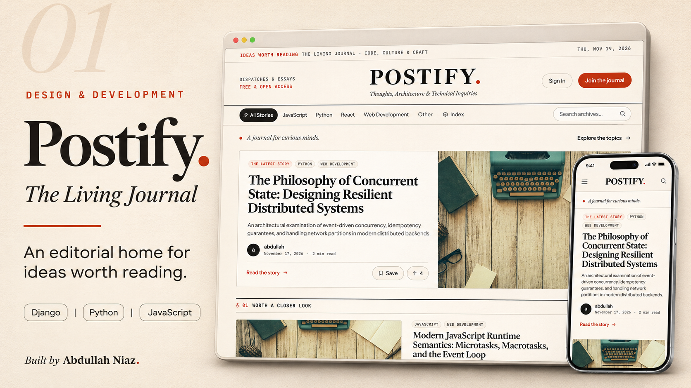

# Postify — The Living Journal

**An editorial home for ideas worth reading.**

Postify is a Django blogging application for publishing technical essays, exploring ideas, and building a personal reading list. Its magazine-inspired interface combines warm ivory surfaces, expressive serif typography, and vermilion accents with a focused reading and writing experience.



*Project showcase mockup. [View the actual homepage screenshot](docs/images/postify-homepage.jpg). The illustrated device layouts are presentation mockups.*

## Features

### Discover and read

- Editorial homepage with a latest-story feature, contrasting secondary stories, and numbered article rows.
- Search article titles and summaries; browse JavaScript, Python, React, Web Development, and Other topics.
- Markdown articles with code blocks, tables, images, and reading-time estimates.
- Reading progress and a desktop table of contents for articles with multiple headings.
- Responsive layouts, keyboard focus indicators, a skip link, and reduced-motion support.

### Write and participate

- Register, sign in, and publish articles with a title, summary, Markdown body, and optional cover image.
- Assign up to three categories to an article.
- Preview cover images and basic Markdown while writing.
- Edit or delete your own articles.
- Save stories to a personal reading list, toggle an upvote, and join discussions with comments.
- Manage articles, users, and comments through a customized Django admin.

Password-change and password-reset pages are included through Django authentication. Password-reset email delivery requires an email backend; the current registration form collects a username and password, not an email address.

## Design

**The Living Journal** takes its visual cues from independent print publications:

- **Palette:** warm ivory, near-black ink, and vermilion.
- **Typography:** Newsreader, Plus Jakarta Sans, and JetBrains Mono, with system fallbacks.
- **Composition:** an editorial masthead, fine rules, generous whitespace, and varied article treatments.
- **Interaction:** clear save/vote states, brief feedback messages, and restrained transitions.
- **Icons:** locally served SVG masks for interface controls.

## Built with

| Layer | Implementation |
| --- | --- |
| Backend | Python and Django; `requirements.txt` currently specifies Django `>=4.2,<6.0` |
| Frontend | Django templates, custom CSS, vanilla JavaScript, and Bootstrap 5 |
| Forms | django-crispy-forms and crispy-bootstrap5 |
| Content | markdown2 and django-multiselectfield |
| Images | Pillow and Django media uploads |
| Local database | SQLite |
| Static files | Django staticfiles and WhiteNoise |

PostgreSQL support packages are included, but the active configuration uses SQLite. No separate frontend build is needed for local development.

## Run locally

Use Python 3.11 or 3.12 and Git. Install into a fresh virtual environment so the project dependencies remain separate from other applications.

### 1. Get the project

```bash
git clone https://github.com/Abdullah-Niaz/postify.git
cd postify
```

### 2. Create and activate an environment

**Windows PowerShell**

```powershell
py -3.12 -m venv env
.\env\Scripts\Activate.ps1
```

If you have Python 3.11 installed instead, use `py -3.11`. If PowerShell blocks activation, run subsequent commands using `.\env\Scripts\python.exe` instead of `python`; activation is optional.

**macOS / Linux**

```bash
python3 -m venv env
source env/bin/activate
```

### 3. Install dependencies and initialize the database

```bash
python -m pip install -r requirements.txt
python manage.py migrate
python manage.py createsuperuser
```

Creating a superuser is optional unless you need access to the admin. Existing migrations are included; `makemigrations` is only necessary when changing models.

### 4. Start the application

```bash
python manage.py runserver
```

Open [Postify](http://127.0.0.1:8000/) or the [admin](http://127.0.0.1:8000/admin/). Register an account and choose **Write Dispatch** to publish your first article.

The current local configuration does not require a `.env` file. `SECRET_KEY`, `DEBUG`, allowed hosts, and SQLite are configured directly in `Postify/settings.py`; adding environment variables alone will not override them.

### Optional demo content

```bash
python manage.py feed_dummy_articles
```

This command adds fictional authors, sample articles, and engagement data for local demonstrations. Use it only with a disposable development database: it creates demo accounts with a shared password defined in the command. The showcase screenshot includes sample content; it does not represent real readership.

## Project structure

```text
postify/
├── Postify/                  # Project settings and root URL configuration
├── blog/
│   ├── management/commands/  # Local demo-content command
│   ├── migrations/           # Database schema history
│   ├── static/blog/          # Source CSS, JavaScript, and images
│   ├── templates/
│   │   └── includes/         # Shared article presentations
│   ├── models.py             # Article and Comment models
│   ├── forms.py              # Article authoring form
│   ├── views.py              # Page views and interaction endpoints
│   └── urls.py
├── accounts/                 # Registration and authentication templates
├── templates/                # Project-level template overrides
├── docs/images/              # README showcase and homepage screenshot
├── media/                    # Local uploads; generated at runtime
├── staticfiles/              # Collected assets; do not edit as source
├── manage.py
├── requirements.txt
└── vercel.json               # Existing deployment configuration; see notes below
```

Categories are stored on each article using `MultiSelectField`, rather than a separate category model. Bookmarks and upvotes are many-to-many relationships with Django users. The model also contains a downvote relation, but the reader interface currently implements upvote toggling only.

## Development

Edit styles and scripts in `blog/static/blog/` and `accounts/static/accounts/`. Update shared templates to keep the homepage, category pages, and reading list consistent.

```bash
python manage.py check
python manage.py test
```

`check` validates Django configuration. The repository does not yet contain a comprehensive automated test suite; a successful test command alone does not establish feature coverage.

Uploaded images belong in `media/`. Static assets can be collected for a configured deployment with:

```bash
python manage.py collectstatic --noinput
```

## Current limitations and deployment notes

This repository is configured for local development. Before making it publicly available:

- Move the secret key and deployment settings to environment-based configuration, disable debug mode, and restrict allowed hosts.
- Restore CSRF enforcement on the interaction views currently marked `csrf_exempt` and verify their JavaScript requests send valid tokens.
- Sanitize rendered Markdown before accepting untrusted authors; the current article view renders HTML without a dedicated sanitization step.
- Configure persistent database and media storage, email delivery, and the static-file backend for the selected Django version and hosting platform.
- Update `vercel.json`: it references a missing `build_files.sh` and an older Python runtime. It is not a verified, ready-to-deploy configuration.

Google Fonts, Bootstrap, and SweetAlert use external resources. Font fallbacks and local icons are included, but the application is not fully offline.

Potential next improvements include pagination, richer Markdown preview parity, author profiles, and automated coverage of permissions and reader interactions.

## Author

Built by **Abdullah Niaz**.

[GitHub](https://github.com/Abdullah-Niaz) · [LinkedIn](https://www.linkedin.com/in/Abdullah-Niaz/)

## License

Released under the [MIT License](LICENSE).
